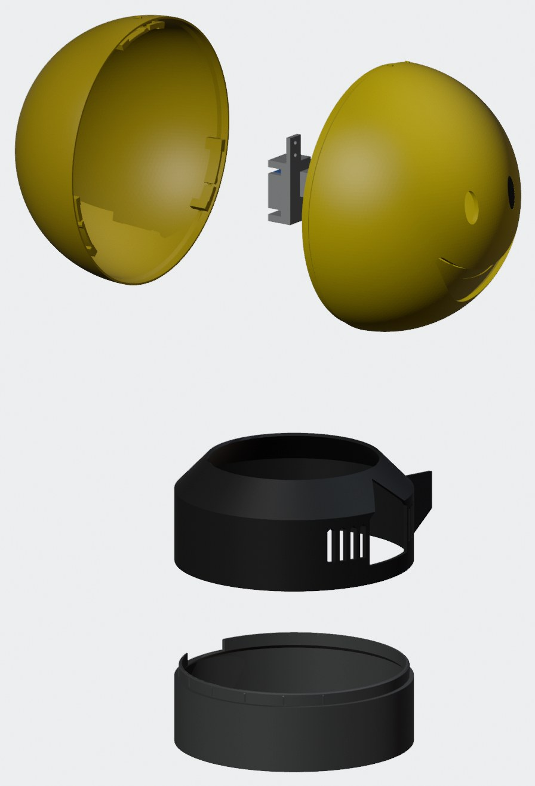
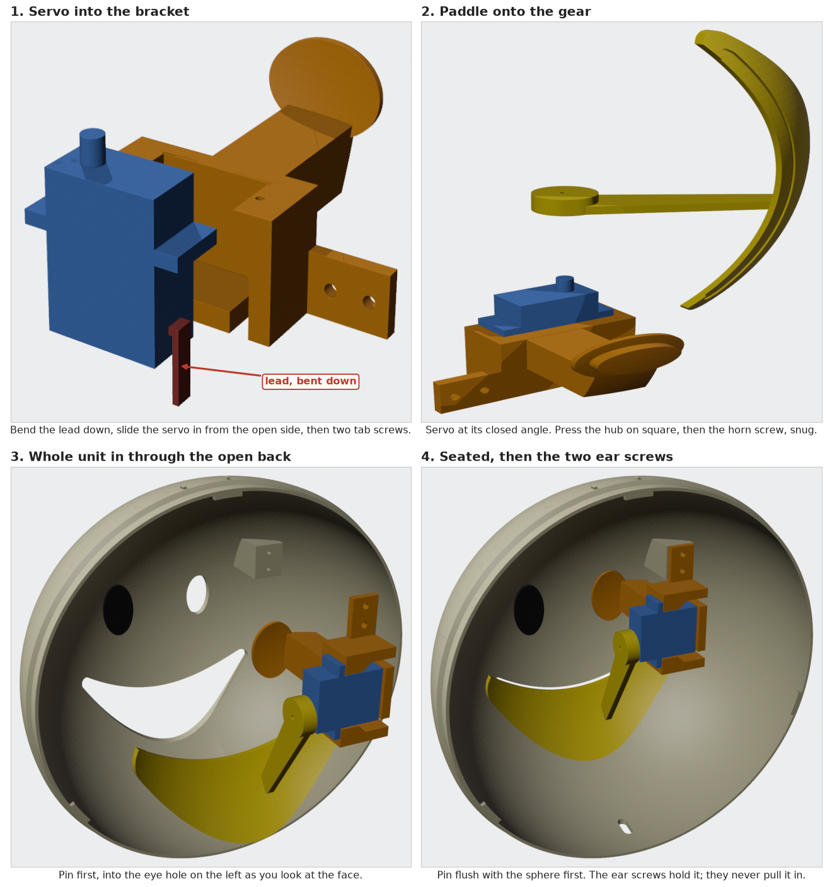
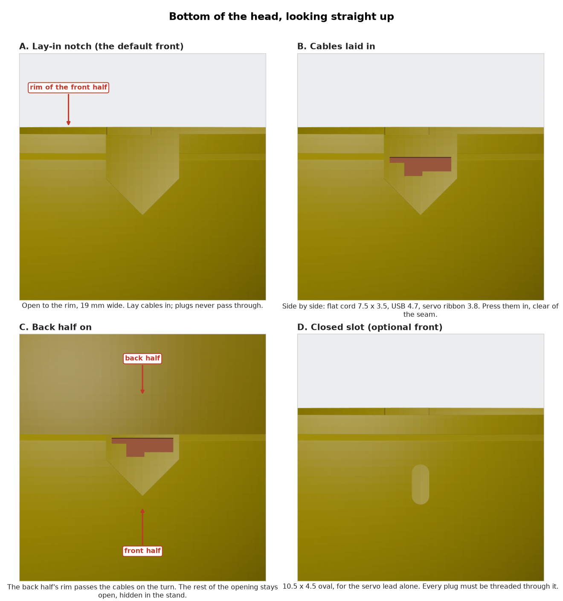
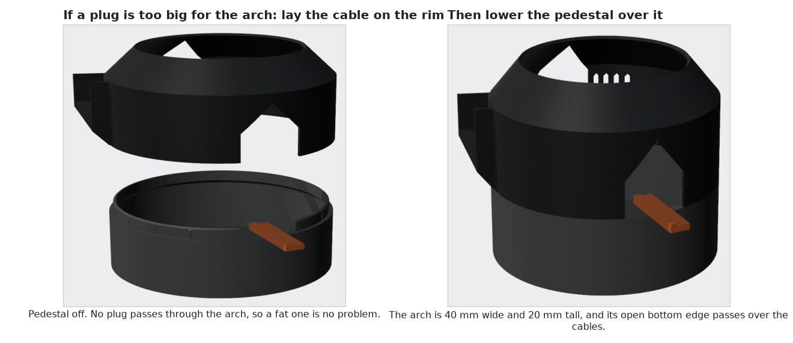
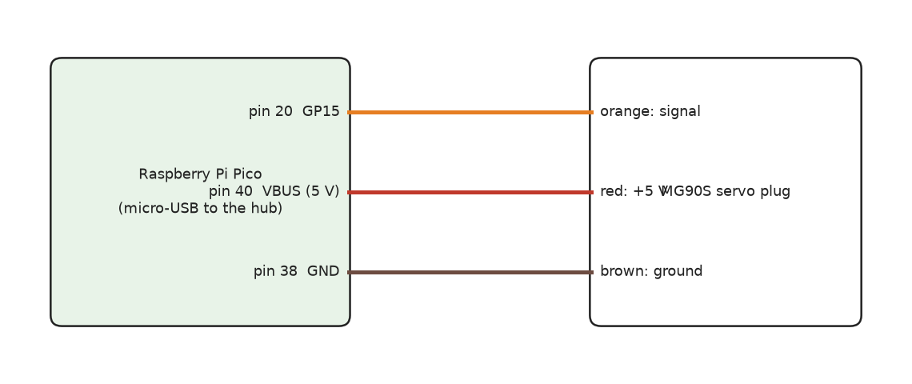

# Assembly

Words first. **Spline**: the small toothed gear on the servo's shaft. **Horn screw**: the short screw in the servo's bag that fits the
threaded hole in that gear. **Pilot**: a small printed hole that a screw cuts its own thread into. **Lip**: the thin ring on the front
half's rim that slides inside the back half. **Lug**: a small bar under that lip. **Riser**: the black cup under the pedestal.

## Before you start

Print **T1** and try the servo's gear in each of its three pockets (the notches on top mark 4.5, 4.6 and 4.7 mm). Pick the largest that
will not twist on the gear. The paddle uses 4.6. If a different pocket wins on your printer, the paddle will be loose or tight: tell
us by opening an issue.

Print **T2 and T3** (T2 has the cable notch, so it proves the seam still holds with it) and try the twist-lock (step 6) before spending 16 hours on the halves. Hold the back hoop still, set the front
hoop on it with the ticks 18 mm apart, and turn. Right: a soft bump, then a hard stop, with fingertip force.

Cleanup: snap the tree supports out of the dome, then scrape the inner wall flat around the mouth and around the eye the bracket
uses. Support marks there tilt everything. Trim the brim's ridge from the lip. On the notched front, take the thin support out of the
notch with pliers and a knife.

## 1. Mouth unit, on the bench

1. **Servo into the bracket.** Hold the bracket with its flat ledge up. Bend the servo's lead down, flat against the case. Slide the
   servo in from the open side until it stops: the end nearest the gear goes farthest from the long strut. The lead drops into the
   slot under the end wall. Two tab screws go into the pilots, a turn at a time, backing off now and then.
2. **Wire it and set closed.** Flash the Pico (below) and wire it up. Send angle 20: that is closed.
3. **Paddle onto the gear.** Press the hub square onto the gear with your thumb on the back of the hub, not on the paddle. Fit the horn
   screw through the hole in the hub, snug, not cranked.
4. **Smile line.** Black tape in the groove along the paddle's top edge. More black tape on the back of the paddle and the inside wall
   behind the mouth: yellow PLA glows, and an open mouth has to look dark.

## 2. Mouth unit into the head

The eye on the left as you face the head is on the bracket. Push the plain plug into the other eye.

1. Cut the support off the yellow post inside the face, scrape its face smooth, and run a screw into each of its two pilots once.
2. Bring the unit in through the open back, pin first, into the eye hole. The eye's face must sit flush with the outside of the sphere.
3. The bracket's **ear** (the thin plate on top) should touch the post just as the pin sits flush. If it touches first, scrape the
   post and try again. **Do not close a gap with the screws:** that tips the whole bracket and the paddle sits deep. A slit left over gets a
   strip of tape as a shim.
4. Two tab screws through the ear into the post, far one first, snug.
5. Run the servo. The paddle must clear the mouth all the way through its swing.

## 3. Cables through the head

The head holds only the servo. Its lead, with the jumper wires, goes down to the Pico in the base.

- **Lay-in front (01):** lay the lead in the notch at the bottom of the head. Other cables go beside it. Press everything fully in,
  away from the rim, before the back goes on, or the back's rim will catch it on the turn. It takes a flat cord 7.5 x 3.5, a USB
  cable 4.7 round and the servo ribbon side by side.
- **Closed-slot front (01b):** thread the servo lead through the oval before the head goes on the stand.

Tape each jumper joint and leave slack, or the plugs pull apart when the head is lifted.

## 4. Base

1. Tape the webcam to the riser's floor, facing the front, tilted up. Tilted fully up it comes within 2 mm of the head, so route
   cables round its sides, not over the top. **Before printing the notched front, test this:** with the real camera at your tilt and
   the head on the stand, can your cables get from the bottom of the head to the back? The servo ribbon always can; thick cables may not, and
   then the camera has to tilt less.
2. Put the hub, Pico and speaker behind it. Connect the Pico, the camera and the speaker's charge lead to the hub.
   Plug the speaker's 3.5 mm lead into the female-to-female adapter, the adapter into the ground loop isolator, and the extension from the
   isolator to the computer.
3. The pedestal sits straight on the riser. Line its back arch up with the gap in the riser's lip and push down. A light push: twelve thin
   ribs grip the pedestal. Too tight: shave the ribs a little with a knife.
4. Run the hub's USB cable, its power cable and the speaker's audio cable out through the arch, which is 40 mm wide and 20 mm tall. A plug too big for that can stay
   outside: lay its cable over the riser's rim and lower the pedestal over it.

## 5. Software test

Run the camera and speaker from your software, and send the jaw angles between 20 and 48. Below 20 the paddle presses into the face.
`firmware/code.py` limits angles to that range and stops holding the servo after a second with no change, which keeps it cool.

## 6. Close the head (twist-lock)

The head sits on the pedestal's ring. Hold on to the front half.

1. Find the small ticks at the top of the seam: one on the back, two on the front.
2. Put the back's tick against the front's far tick and set the back on. It drops about 5 mm with no force.
3. Hold the back still and turn the face clockwise, as you look at it, about 12 degrees: a soft bump, then a hard stop. The tick now sits
   against the front's other tick. Locked.
4. To open, turn it back past the bump and lift off. Pulling without turning does nothing.

The head is a ball on a ring: two dabs of hot glue or a strip of Velcro keep it there.

## Pico

1. Hold BOOTSEL, plug the Pico in and drag the CircuitPython UF2 onto the RPI-RP2 drive.
2. Copy `firmware/boot.py` and `firmware/code.py` to the CIRCUITPY drive, and `adafruit_motor` from the CircuitPython library bundle to
   `CIRCUITPY/lib`. Power-cycle it.
3. The Pico now shows two serial ports. Send one byte per frame to the data port (the higher-numbered one): the angle, about 50 times a
   second. No byte for half a second closes the mouth.

Keep the Pico on the powered hub: stalls near 1 A can reset a computer's port.
