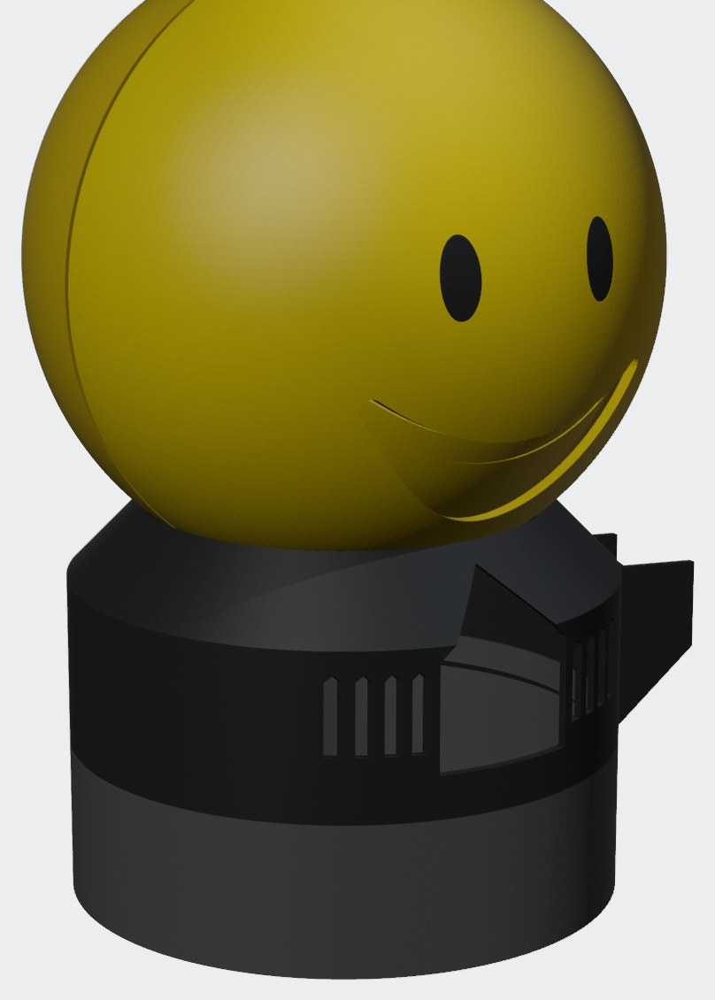
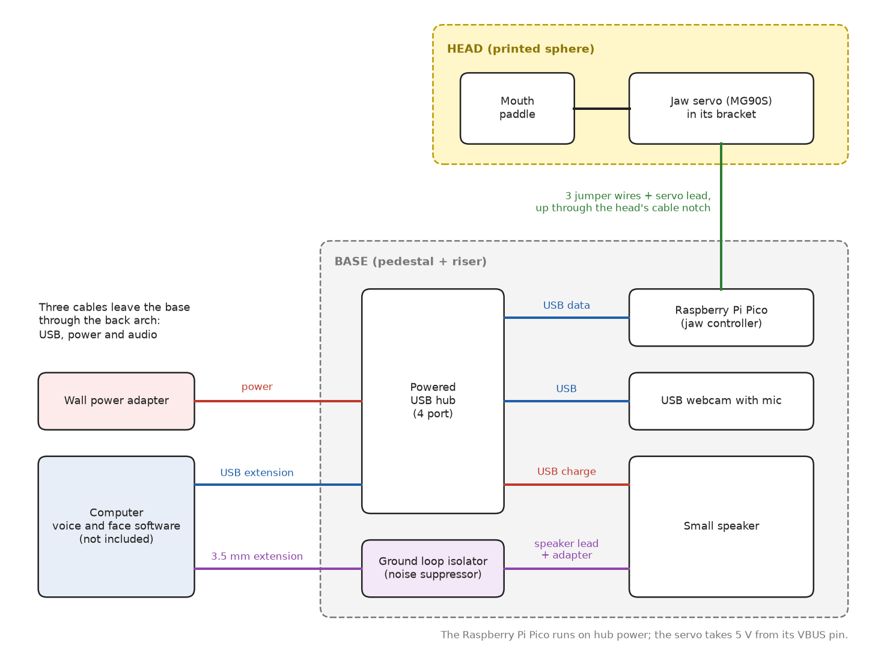

# Talkbot Head

A 170 mm round yellow head with a servo-driven mouth, on a stand that holds a webcam, a speaker and a USB hub. Plug it into
a computer and it can look, listen and move its mouth in time with speech. These are the printed parts, the wiring and the
small jaw firmware. **The voice and face software is not included:** bring your own. The jaw needs one byte per frame over USB
serial (see `firmware/code.py`), so anything that can open a serial port can drive it.

## Status

| Part | State |
|---|---|
| Back half, paddle, bracket, eye plug, pedestal, riser | Printed and assembled on one A1 mini build |
| Front half with the closed slot (`01b`) | Printed and assembled on the same build |
| Front half with the lay-in notch (`01`) | **Modelled, sliced and reviewed. Not printed yet.** Thick cables also need a bench test: see Assembly, Base |

Every part was printed once, on one printer. Fits are measured on that printer only. Test pieces are included for that reason.

## Files

The parts are attached to each release of this repo as a zip, as `.3mf` (ready to print, Bambu Studio) and `.stl`.

| # | Part | Colour | Layer | Supports | Time | Filament |
|---|---|---|---|---|---|---|
| 01 | Front half, lay-in cable notch | yellow | 0.16 | tree, plate only | 8 h 56 m | 170 g |
| 01b | Front half, closed slot (print this **or** 01) | yellow | 0.16 | tree, plate only | 8 h 57 m | 171 g |
| 02 | Back half | yellow | 0.20 | tree, plate only | 7 h 32 m | 166 g |
| 03 | Mouth paddle | yellow | 0.20 | tree, plate only | 0 h 55 m | 12 g |
| 04 | Servo bracket, with one eye on it | black | 0.20 | tree, plate only | 0 h 57 m | 13 g |
| 05 | Eye plugs, three tightnesses (you need one) | black | 0.12 | no | 0 h 29 m | 4 g |
| 06 | Pedestal | black | 0.20 | no | 3 h 34 m | 89 g |
| 07 | Riser | black | 0.20 | no | 2 h 57 m | 98 g |
| T1 | Test: gear fit, three pocket sizes | yellow | 0.20 | no | 0 h 19 m | 3 g |
| T2 | Test: twist-lock, front hoop with the notch | yellow | 0.20 | no | 0 h 41 m | 15 g |
| T3 | Test: twist-lock, back hoop | yellow | 0.20 | no | about 1 h | 22 g |

About 25 h in all: 350 g yellow, 200 g black, PLA. Times are slicer estimates. **Which front:** print 01 unless you are sure only
the servo lead will ever go through the head. Lay-in means no plug ever has to pass through, so a fat one is no problem.

**Printers.** Set up and printed on a Bambu Lab A1 mini (180 x 180 x 180 mm bed). The halves are 170 mm across and take a 3 mm
brim, so they need a bed of at least 180 x 180 mm. Each `.3mf` holds A1 mini, 0.4 mm nozzle, PLA settings. A larger printer will
fit every part, but those settings were made for the A1 mini, so re-slice for your machine. Other brands can use the `.stl` files
with the layer and support settings above. Each half stands on a thin ring, and the notched front's ring is open at the notch: watch its first layers.

## Parts to buy

| Item | Note |
|---|---|
| MG90S servo, metal gears | Its bag has the tab screws and the horn screw. Clones differ: check yours fits the bracket |
| 2 more tab screws | From a second servo's bag. They hold the bracket's ear (9.5 mm long, 5 mm head) |
| Raspberry Pi Pico | The plain one. Runs CircuitPython |
| Micro-USB **data** cable | Charge-only cables will not show up on the computer |
| 3 male-to-female jumper wires, 20 cm or longer | Pico to servo lead. Tape the joints |
| Powered USB hub, 4 port | Unpowered ports dropped the Pico on big jaw swings. Powered: no drop-outs |
| Logitech C920e webcam | The pedestal and riser are sized for it. Check first if you use another |
| Small speaker | Anything that fits in the base beside the camera |
| USB extension and hub power adapter | To reach the computer and the wall |
| 3.5 mm audio extension cable, female-to-female adapter, ground loop isolator | Computer to speaker. The isolator stops the hum you can get with the speaker charging from the same hub |
| Black tape, hobby knife, small screwdriver | For the smile line, support cleanup and the screws |

Nothing here needs drilling, and the eye plug needs no glue.

## How it connects

Assembly: [ASSEMBLY.md](ASSEMBLY.md). Changes: [CHANGELOG.md](CHANGELOG.md).

## Keep it safe

This is an adult build and not a toy: small parts, a powered servo, and no testing to any toy-safety standard. Stay nearby if children are
around it. The stand has a camera and microphones in it: tell people they are there, and think about what your software records and
where that goes. Children's voices deserve extra care.

## License

Models, pictures and instructions: CC BY-NC-SA 4.0. Firmware: MIT. Designed by FJ Osprey, with the modelling done in code by an AI
assistant under the designer's direction.
